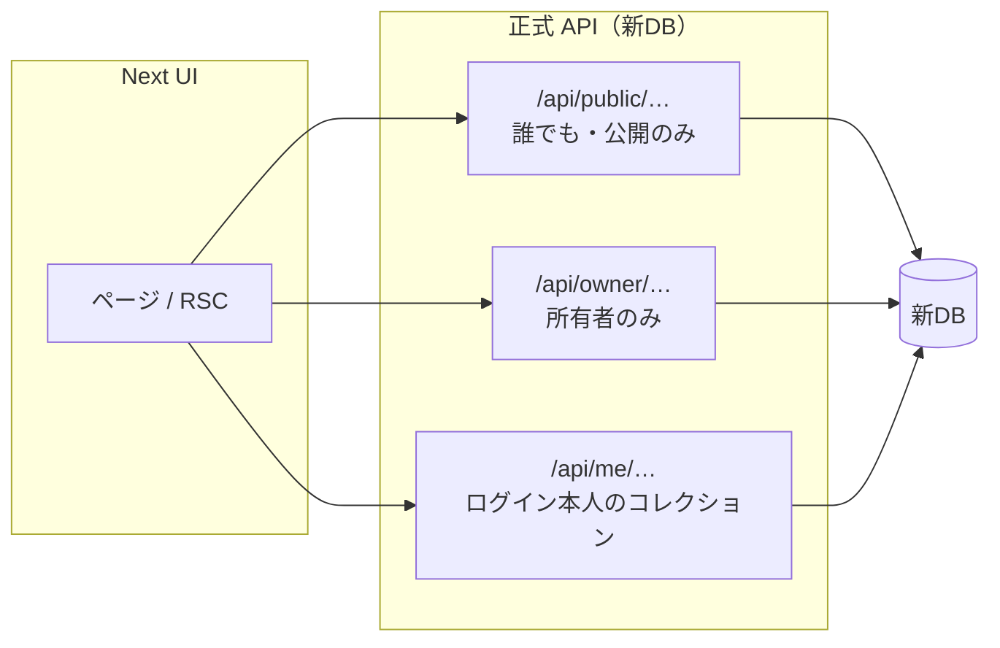
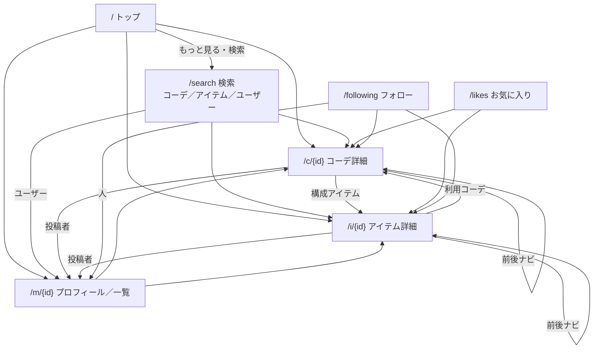
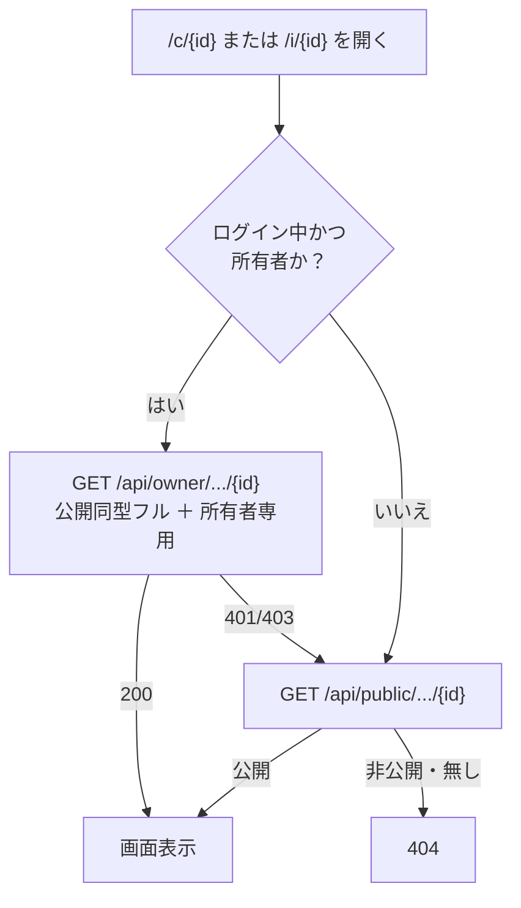
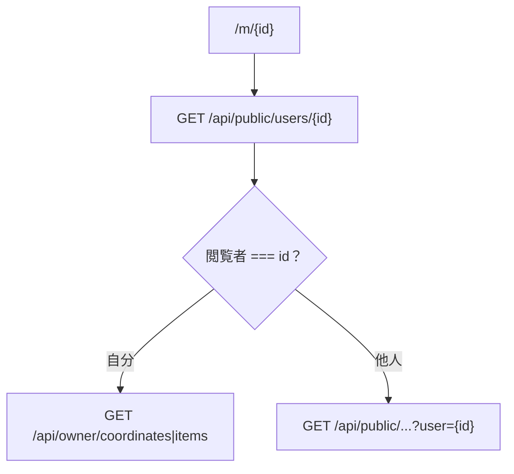

# システム俯瞰（読み取り）— 画面・導線・API

社内／着任時に **全体を一目で見る**ための資料。  
**渡すセット:** [`HANDOFF.md`](./HANDOFF.md)。エンドポイント早見は [`API_CATALOG.md`](./API_CATALOG.md)。

**スコープ:** 主に読み取りの画面・導線。書き込みは [`WRITE_PATH.md`](./WRITE_PATH.md) ・ [`../spike/docs/API.md`](../spike/docs/API.md)。

---

## 1. 全体像

| 口 | 使う画面のイメージ |
|----|-------------------|
| `public` | トップ・検索・他人プロフ・公開詳細 |
| `owner` | 自分のマイページ一覧・本人用詳細フル |
| `me` | いいね・フォローした投稿 |

---

## 2. 主な画面の関係（導線）

ヘッダー／メニューからも Search・Likes・Following・自分の `/m/{自分}` へ行ける。

---

## 3. 画面 × API（読み取り）

| 画面 | 主な API | メモ |
|------|----------|------|
| `/` | `GET /api/public/coordinates` ・ `items`（`page=1&per_page=9`） | 先頭9件（3×3）。`meta` 省略可 |
| `/search`（コーデ／アイテム） | 同上 ＋ `q` / `tag` / `g` / `season` / `cat` / `obi` 等 | **`meta` 必須**。1ページ分だけ |
| `/search?m=u`（ユーザー） | `GET /api/public/users`（`q`・`page`・`per_page`） | **`q` 未指定は空一覧**。名前／bio。名前順 |
| `/c/{id}` | 本人 → `GET /api/owner/coordinates/{id}`（フル） それ以外 → `GET /api/public/coordinates/{id}` | 非公開は public で **404**。下部「他のコーデ」は詳細内 `related_coordinates`（最大9・同ユーザー公開） |
| `/i/{id}` | 同上（`items`） | 下部「他のアイテム」は `related_items`。利用コーデは `used_in_coordinates`（いずれも詳細同梱） |
| 詳細の紐づけモーダル一覧 | `GET /api/owner/coordinates` または `items` | 所有者のみ。非公開含む本人一覧。**確定保存 API は未契約** |
| 詳細の前後（直リンク） | `GET .../{id}/neighbors` | 短い窓。全件禁止 |
| `/m/{id}` 人物 | `GET /api/public/users/{id}` | 公開プロフィール／名刺 |
| `/m/{他人}` 一覧 | `GET /api/public/coordinates\|items?user={id}` | **公開のみ** |
| `/m/{自分}` 一覧 | `GET /api/owner/coordinates` ・ `items` | 非公開含む本人一覧 |
| `/likes` | `GET /api/me/favorites?kind=...` | 未ログインは API を叩かず誘導 |
| `/following` | `GET /api/me/following/posts?kind=...` | 同上 |

フィールド・必須任意: [`API_CONTRACT.md`](./API_CONTRACT.md)  
一覧の作り方: [`LIST_QUERY_ARCHITECTURE.md`](./LIST_QUERY_ARCHITECTURE.md)

---

## 4. 詳細の出し分け（権限）

**権限の正はサーバ。** フロントの隠し表示やモック Cookie を本番の正にしない。

---

## 5. マイページ（自分／他人）

他人一覧に非公開を混ぜない。公開 API に「自分のときだけ非公開も返す」flag を足さない。

---

## 6. 会員コレクション

| 画面 | 条件 | 動き |
|------|------|------|
| `/likes` | 未ログイン | 一覧 API なし → 会員誘導 |
| `/likes` | ログイン | `GET /api/me/favorites` |
| `/following` | 未ログイン | 投稿一覧 API なし（おすすめ等のみ可） |
| `/following` | ログイン | `GET /api/me/following/posts` |

公開一覧に `scope=favorite|following` は **置かない**（口を分ける）。

---

## 7. この図の使い方

| 目的 | 次に見るもの |
|------|----------------|
| API を実装する | [`API_FOR_ENGINEERS.md`](./API_FOR_ENGINEERS.md) → [`packs/`](./packs/) |
| パス／クエリの正 | [`API_CATALOG.md`](./API_CATALOG.md) ・ [`openapi.yaml`](./openapi.yaml) |
| フィールド | [`API_CONTRACT.md`](./API_CONTRACT.md) |
| 書き込み・投稿 UI | [`WRITE_PATH.md`](./WRITE_PATH.md)（本資料の外） |

図と表が契約と食い違うときは **CATALOG / CONTRACT を正**とし、本資料を直す。
